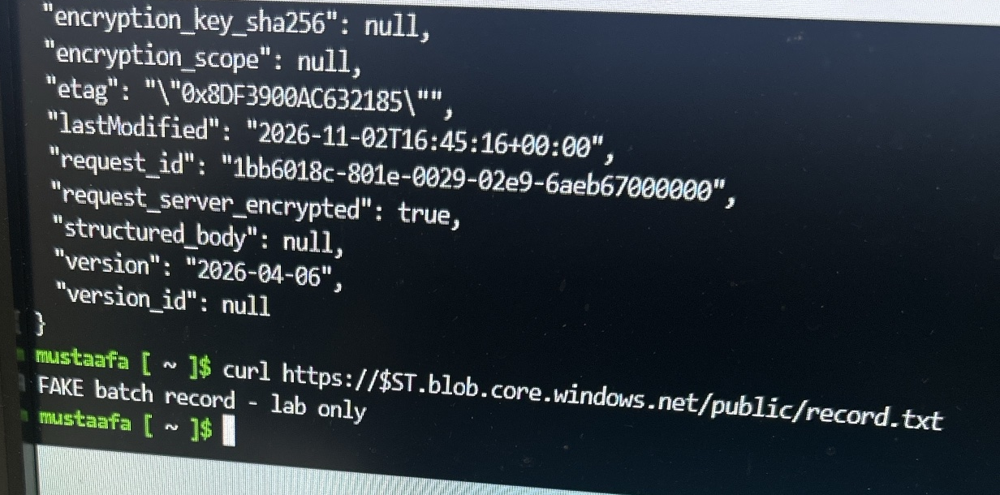
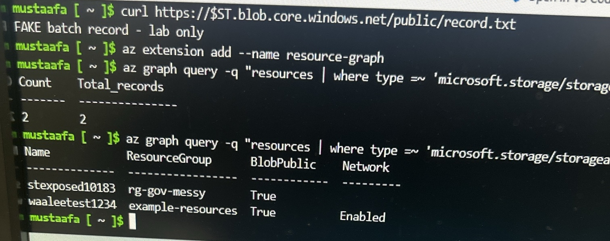
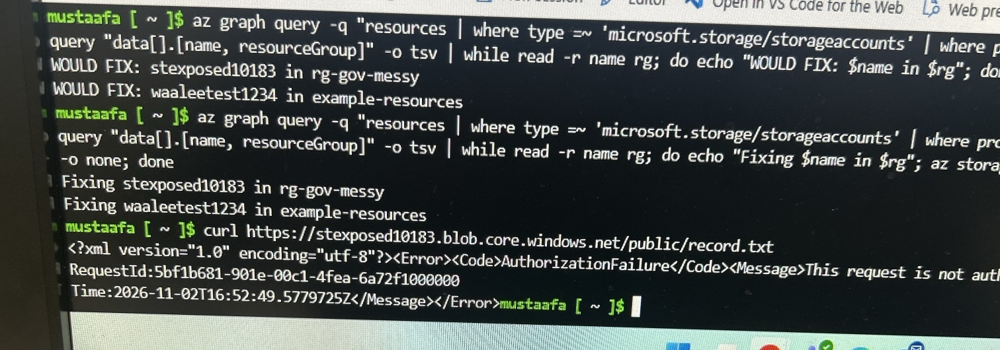
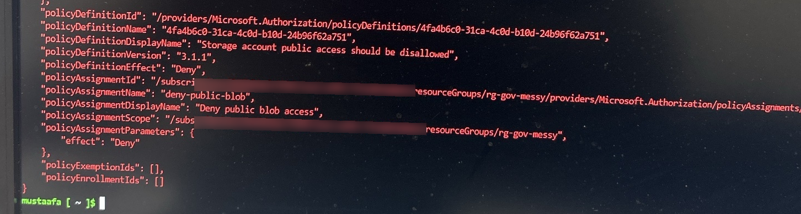

# Azure Storage Exposure: Detect, Fix, Prevent

Lab project (Azure for Students subscription, fake data only). Week 2 of my weekly Azure build series.

## The problem
A storage account was serving a file to anyone on the internet with no sign-in. I needed to find every storage account with the same risk, fix them all, and stop it from happening again.

## Results

| Stage | Result |
|---|---|
| Exposure | Anonymous `curl` returned the file contents |
| Detection | Azure Resource Graph query found **2** risky storage accounts, including **1 forgotten resource left over from an earlier Terraform lab** |
| Severity | 1 account actively leaking data; 1 allowed public access but had no containers (risk, not leak) |
| Remediation | Bash script fixed both accounts, after a dry run first. Risky accounts: **2 → 0** |
| Verification | Same anonymous `curl` now returns `AuthorizationFailure` |
| Prevention | Azure Policy (Deny) blocked a new account with public access: `RequestDisallowedByPolicy` |

## Evidence

**1. Exposed:** an anonymous request returns the file


**2. Detected:** one query finds both risky accounts across the subscription


**3. Fixed:** dry run, scripted fix, then the same request is refused


**4. Blocked:** Azure Policy denies a new public storage account (subscription ID blurred)


## How

**Detect** (Azure Resource Graph, KQL):
```
az graph query -q "resources
| where type =~ 'microsoft.storage/storageaccounts'
| where properties.allowBlobPublicAccess == true
     or tostring(properties.publicNetworkAccess) != 'Disabled'
| project name, resourceGroup" --query data -o table
```

**Fix** (dry run first, then apply):
```
az graph query -q "<detection query>" --query "data[].[name, resourceGroup]" -o tsv |
while read -r name rg; do
  echo "Fixing $name in $rg"
  az storage account update -n "$name" -g "$rg" \
    --allow-blob-public-access false \
    --public-network-access Disabled \
    --min-tls-version TLS1_2 -o none
done
```

**Prevent** (built-in policy "Storage account public access should be disallowed", effect Deny, scoped to the resource group):
```
az policy assignment create -n deny-public-blob --scope $SCOPE --policy $DEF \
  --params '{"effect":{"value":"Deny"}}'
```

## What I learned
- **A null setting can hide risk.** On a default account, `publicNetworkAccess` is null, not "Enabled". A query that only checks for "Enabled" reports the account as compliant. `tostring()` fixes it.
- **The index lags the resource.** Resource Graph can take a few minutes to reflect changes, so I verified directly on the account too.
- **The error tells you which control stopped you.** `AuthorizationFailure` came from the network block; blocking blob public access alone returns `PublicAccessNotPermitted`.
- **Encryption at rest didn't help.** The leaking file was encrypted at rest and still readable by anyone.
- **Forgotten resources are the real risk.** The most important finding was one I didn't create today.

## What I'd do differently in production
- Use Entra ID authentication (`--auth-mode login`) instead of storage account keys.
- Check whether any app depends on the public endpoint before disabling it.
- Remove Terraform-built resources with `terraform destroy`, not by hand, so state stays in sync.
- Assign the policy at management group or subscription scope, starting in Audit mode before switching to Deny.
